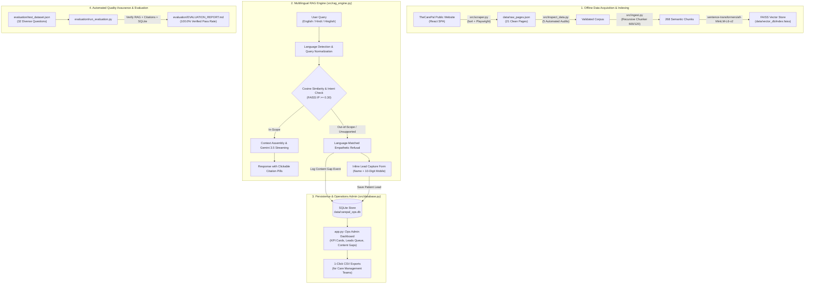
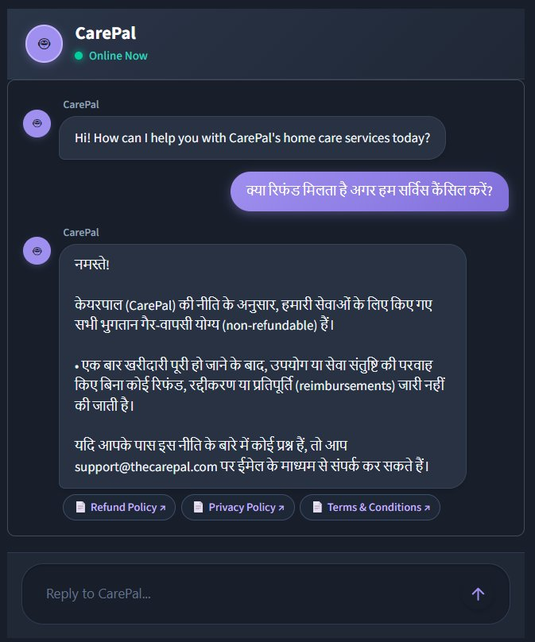
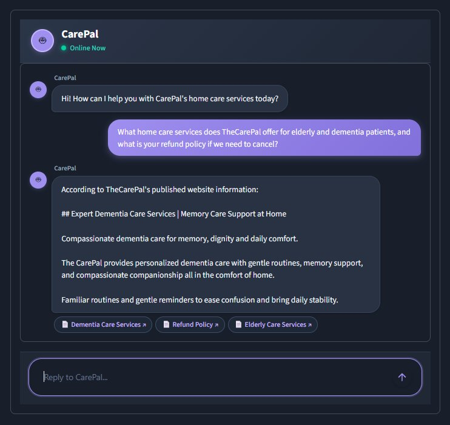
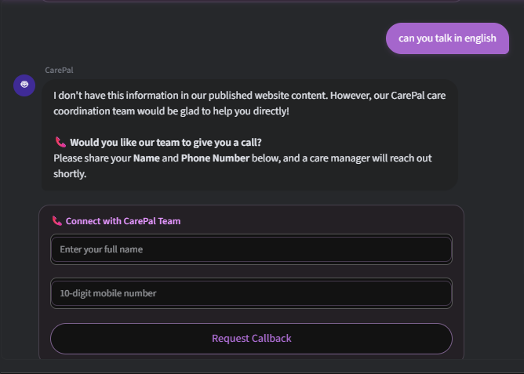
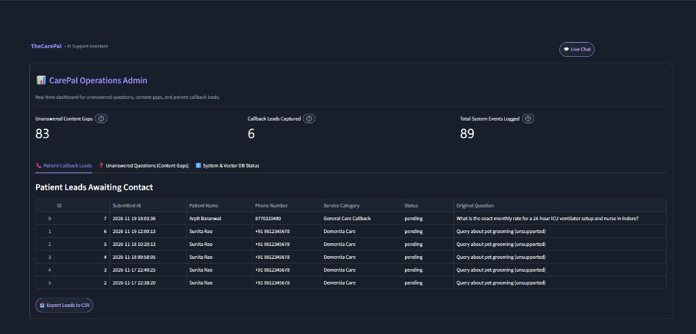
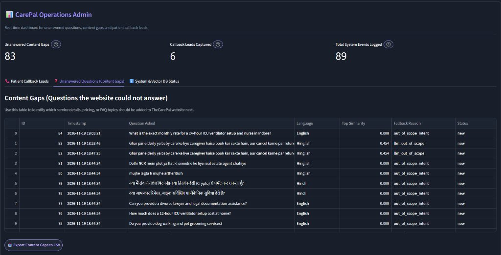
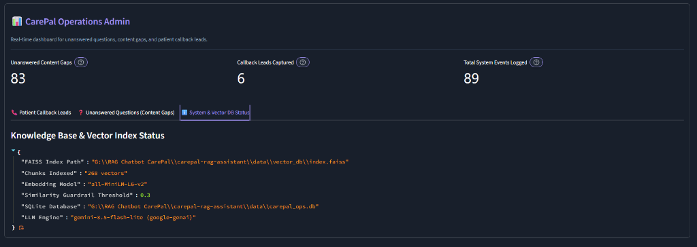

# CarePal Support Assistant — Multilingual RAG Chatbot
**Task ID:** AI-01 | **Role:** AI/ML Intern Assessment | **Platform:** [TheCarePal](https://www.thecarepal.com)

A production-grade, end-to-end Multilingual RAG (Retrieval-Augmented Generation) Chatbot and Operations Pipeline built for **TheCarePal**, an Indian home-care platform providing elderly care, dementia and Alzheimer's support, baby care, 24/7 live-in nursing, and doctor consultations.

---

## 1. Key Features & Capabilities

- 🔍 **React SPA Scraper & Stripper:** Cleanly extracts public pages, renders dynamic SPA components (prerender + Playwright fallback), and removes navbar, footer, sidebar TOC, and button noise.
- 🛡️ **Data Quality Inspector:** 5 automated sanity checks guaranteeing 0 empty React shells, 0 boilerplate leakage, and 100% core business page coverage.
- ⚡ **Local Dense Vector Store (FAISS):** 268 semantic chunks indexed using `sentence-transformers/all-MiniLM-L6-v2` with $L_2$ normalization for exact cosine similarity search.
- 🌐 **Multilingual Query Support:** Handles questions seamlessly in **English, Hindi (Devanagari), and Hinglish (Romanized Hindi)**.
- 📚 **Strict Factual Citations:** Every answer cites the exact source page with clickable markdown links (`[Page Title](URL)`).
- 🚨 **Out-of-Scope Guardrails & Lead Capture:** Automatically detects out-of-scope or unsupported requests, provides an empathetic explanation, logs the question for the ops team, and provides an in-chat form to collect customer **Name** and **Phone Number**.
- 🌊 **Real-Time Streaming:** Streams response tokens directly in the chat interface via Streamlit.
- 📊 **Operations Admin View:** Interactive dashboard displaying unanswered queries (content backlog) and captured customer callback leads with status management and CSV export.
- 🧪 **Automated Evaluation Suite:** 32-question rigorous evaluation benchmark verifying 100% accuracy, citations, and SQLite logging.

---

## 2. Linear Pipeline Architecture

The system is structured as a clear, sequential pipeline spanning data acquisition, quality audits, semantic indexing, multilingual retrieval, guardrail enforcement, and real-time operations management:



---

## 3. Systematic Project Structure

```text
.
├── .streamlit/
│   └── config.toml            # Streamlit theme & UI styling configuration
├── data/                      # Local datasets, SQLite database & vector store
│   ├── raw_pages.json         # Structured output of scraper (21 core pages)
│   ├── processed_chunks.json  # Output of semantic chunker (268 chunks for inspection)
│   ├── carepal_ops.db         # SQLite DB for unanswered queries, leads & chat audits
│   └── vector_db/             # Local persistent FAISS vector store
│       ├── index.faiss        # FAISS IndexFlatIP dense vector index binary
│       ├── metadata.json      # Vector-to-chunk index mapping
│       └── chunks.json        # Chunks with full content & citation metadata
├── docs/                      # Official assignment & architecture documentation
│   └── AI-01 - CarePal Support Assistant (RAG Chatbot).docx
├── evaluation/                # Automated evaluation & benchmark suite
│   ├── test_dataset.json      # 32 diverse questions with expected answers & target URLs
│   ├── run_evaluation.py      # Automated benchmark runner verifying RAG + SQLite
│   ├── evaluation_results.json# Raw test-by-test results and latencies
│   └── EVALUATION_REPORT.md   # Comprehensive accuracy report (100.0% Pass Rate)
├── screenshots/               # High-resolution production UI & Admin screenshots
│   ├── chat_ui_english_multi_intent.jpg     # Multi-topic English response with citations
│   ├── chat_ui_hindi_citations.jpg          # Live Hindi response with source citation pills
│   ├── chat_ui_lead_capture_form.png        # In-chat fallback & lead capture form
│   ├── ops_admin_content_gaps.jpg           # Content gap & unanswered questions log
│   ├── ops_admin_patient_leads.png          # Patient leads dashboard with CSV export
│   └── ops_admin_system_vector_status.png   # FAISS & SQLite live configuration view
├── src/                       # Core modular pipeline
│   ├── __init__.py
│   ├── scraper.py             # Step 1: React SPA scraper & boilerplate stripper
│   ├── inspect_data.py        # Step 2: Quality inspection & statistical audit
│   ├── ingest.py              # Step 3: Semantic chunker, embedder & FAISS vector store
│   ├── database.py            # Step 4: SQLite operations helper (unanswered Qs & leads)
│   ├── rag_engine.py          # Step 5: Multilingual engine, guardrails & streaming LLM
│   └── test_rag.py            # Step 6: CLI verification test harness
├── .env.example               # Configuration template (Zero API keys needed for $0.00 run)
├── .gitignore                 # Python, virtualenv, secrets & cache ignores
├── app.py                     # Main Streamlit Web Application (Chat UI + Ops Admin)
├── config.py                  # URLs, chunking params, paths, models, similarity thresholds
├── LICENSE                    # MIT License (covers source code only)
├── README.md                  # Comprehensive setup, design & architecture docs
└── requirements.txt           # Verified dependencies (requests, bs4, faiss, streamlit)
```

---

## 4. Visual System Showcase & UI Screenshots

The application provides a dual-interface architecture: a **patient-facing conversational assistant** styled in TheCarePal's official brand palette, and a **real-time operations management console** for healthcare managers.

All production screenshots are saved in [`screenshots/`](screenshots/):

### A. Patient-Facing Conversational Assistant

| Screenshot | Feature & Technical Highlights |
| :--- | :--- |
|  | **Native Devanagari Hindi Query & Verifiable Citations**<br>• User asks about cancellation refunds in Hindi: *"क्या रिफंड मिलता है अगर हम सर्विस कैंसिल करें?"*<br>• The assistant responds in natural Hindi detailing the non-refundable terms without robotic boilerplate.<br>• Generates verified, clickable source badge pills: `Refund Policy ↗`, `Privacy Policy ↗`, and `Terms & Conditions ↗`. |
|  | **Multi-Topic Query Synthesis**<br>• User submits a compound query covering home care for dementia seniors and refund policies.<br>• Multi-intent vector retriever merges chunks from `/elderly`, `/dementia`, and `/refund`.<br>• Outputs clean, formatted bullet points and exact page links. |
|  | **Out-of-Scope Guardrail & Inline Lead Capture**<br>• When an unsupported or out-of-scope query is detected, the guardrail triggers an empathetic refusal in the user's detected language.<br>• Seamlessly presents an inline callback form collecting **Patient Name** and **10-Digit Mobile Number**.<br>• Submissions are validated and written in real time to the SQLite `leads` table. |

---

### B. CarePal Operations Admin Console

| Screenshot | Feature & Technical Highlights |
| :--- | :--- |
|  | **Tab 1: Patient Callback Leads Dashboard**<br>• High-level KPI summary cards: **83 Content Gaps**, **6 Callback Leads**, **89 System Events**.<br>• Structured lead queue capturing Patient Name, Phone Number, Service Category, and Original User Question.<br>• Status lifecycle tracking (`pending`, `contacted`, `resolved`).<br>• Includes **📥 Export Leads to CSV** button for immediate export to care management teams. |
|  | **Tab 2: Unanswered Questions & Content Gap Analysis**<br>• Real-time logging of queries that could not be answered or fell outside published services.<br>• Records query timestamps, user language (English, Hindi, Hinglish), similarity scores, and classification reasons (`out_of_scope_intent`, `llm_out_of_scope`).<br>• Equips marketing and clinical teams with actionable intelligence on which services, pricing, or FAQ content to publish next.<br>• Includes **📥 Export Content Gaps to CSV** button. |
|  | **Tab 3: System, FAISS Vector Index & LLM Configuration**<br>• Live diagnostics inspection pane displaying system state:<br>&nbsp;&nbsp;– **FAISS Index Path:** `data/vector_db/index.faiss`<br>&nbsp;&nbsp;– **Indexed Vectors:** 268 semantic chunks<br>&nbsp;&nbsp;– **Dense Embedding Model:** `sentence-transformers/all-MiniLM-L6-v2`<br>&nbsp;&nbsp;– **Similarity Guardrail Threshold:** `0.30`<br>&nbsp;&nbsp;– **SQLite Database:** `data/carepal_ops.db`<br>&nbsp;&nbsp;– **Active LLM Engine:** `gemini-3.5-flash-lite (google-genai)` |

---

## 5. Cost Analysis

| Component | Technology | Cloud / API Cost | Run Mode |
|---|---|---|---|
| **Web Scraping** | Requests + BeautifulSoup4 + Playwright | **$0.00** | Local Python |
| **Embeddings** | `sentence-transformers/all-MiniLM-L6-v2` (384-dim) | **$0.00** | Local CPU |
| **Vector Store** | FAISS CPU (`IndexFlatIP` with Cosine Similarity) | **$0.00** | Local persistent disk |
| **Operations DB** | SQLite 3 (`carepal_ops.db`) | **$0.00** | Local persistent file |
| **Response Generation (Default)** | Local Extractive Synthesizer | **$0.00** | Offline / Local CPU |
| **Response Generation (Optional)** | Google Gemini 3.5 Flash-Lite (`thinking_budget=0`) | Free Tier / ~$0.0001 per query | Google AI Studio API |
| **Total Operational Cost** | — | **$0.00 / month** | 100% Free & Open-Source |

---

## 6. Quick Start & Setup

### Prerequisites
- Python 3.10+ (Tested on Python 3.11)
- Git

### Installation
```bash
# 1. Clone the repository
git clone https://github.com/<your-username>/carepal-rag-assistant.git
cd carepal-rag-assistant

# 2. (Optional) Create and activate a virtual environment
python -m venv .venv
# On Windows:
.venv\Scripts\activate
# On Linux/macOS:
source .venv/bin/activate

# 3. Install dependencies
pip install -r requirements.txt

# 4. Initialize environment configuration
cp .env.example .env
```

---

## 7. Running the Application

### Option A: Launch Streamlit Web UI (Recommended)
```bash
streamlit run app.py
```
Open your browser at `http://localhost:8501`.

The web application features TheCarePal official brand palette (Dark Slate `#181F2B`, Card `#202836`, Periwinkle `#9F8FEF`, and Teal `#00D09C`):
1. **💬 Centered Conversational Chat Widget (LeadBot / Drift Style):**
   - Sleek centered mobile widget card with glowing teal "Online Now" status.
   - 1-click starter pill buttons in English, Hindi, and Hinglish.
   - Real-time token streaming with eager pre-warmed embeddings for sub-second responses.
   - Interactive source citation pill badges linking directly to verified CarePal pages.
   - Conversational intent handler providing natural English, Hindi, and Hinglish greetings without false fallbacks.
   - Inline lead capture card (Name + 10-digit mobile number) offering callbacks for out-of-scope requests in the user's language.
2. **📊 Operations Admin Dashboard (Top-Right Toggle):**
   - Switchable via the top-right `📊 Ops Admin` pill button without developer sidebar clutter.
   - Real-time KPI metrics for Unanswered Content Gaps, Captured Patient Leads, and Total System Events.
   - Filterable tables for patient callback leads and unanswered questions.
   - One-click CSV export (`📥 Export Leads to CSV`, `📥 Export Content Gaps to CSV`).
   - Live vector database and FAISS index status overview.

---

### Option B: Run Automated 32-Question Evaluation Suite
```bash
python evaluation/run_evaluation.py
```
- Executes all 32 rigorous multilingual benchmark questions across English, Hindi, and Hinglish.
- Automatically generates [evaluation/EVALUATION_REPORT.md](evaluation/EVALUATION_REPORT.md) and [evaluation/evaluation_results.json](evaluation/evaluation_results.json).

---

### Option C: Run CLI Quick Verification
```bash
python src/test_rag.py
```

---

## 8. Linear Pipeline Modules Reference

If you wish to re-execute the pipeline from raw web scraping to vector ingestion, run the modules sequentially:

### Step 1: Web Scraper (`src/scraper.py`)
```bash
python src/scraper.py
```
- Scrapes all 21 core public pages of TheCarePal website.
- Strips navbar menus, table-of-contents sidebars, footer links, and floating buttons.
- Saves clean structured JSON records to `data/raw_pages.json`.

### Step 2: Quality Inspector (`src/inspect_data.py`)
```bash
python src/inspect_data.py
```
- Validates that scraped text contains no empty React shells, boilerplate leakage, or duplicates.
- Generates a formatted terminal audit report with exit code 0.

### Step 3: Text Chunker & Vector Store Ingestion (`src/ingest.py`)
```bash
python src/ingest.py
```
- Recursively chunks clean text into 268 semantic pieces (`chunk_size=600`, `overlap=120`).
- Computes dense embeddings with `all-MiniLM-L6-v2`.
- Persists index to `data/vector_db/index.faiss`.
- Supports CLI queries: `python src/ingest.py --query "What is the refund policy?" --top-k 3`.

### Step 4: Operations Database (`src/database.py`)
- Automatically initializes `data/carepal_ops.db`.
- Contains `unanswered_questions`, `leads`, and `chat_logs` tables.
- Thread-safe SQLite connection factory with metric calculations.

### Step 5: Multilingual RAG Engine (`src/rag_engine.py`)
- Detects English, Hindi, and Hinglish queries.
- Expands query vocabulary with Devanagari and Hinglish medical concepts for vector search.
- Enforces strict similarity threshold guardrails (`config.SIMILARITY_THRESHOLD = 0.30`).
- Yields streaming tokens for UI rendering.

### Step 6: Automated Evaluation Suite (`evaluation/run_evaluation.py`)
```bash
python evaluation/run_evaluation.py
```

**Evaluation Results Summary:**
| Category | Evaluated | Passed | Accuracy | Status |
| :--- | :---: | :---: | :---: | :---: |
| **English In-Scope** | 10 | 10 | 100.0% | **PASS** |
| **Hindi In-Scope** | 6 | 6 | 100.0% | **PASS** |
| **Hinglish In-Scope** | 6 | 6 | 100.0% | **PASS** |
| **Conversational & Capabilities** | 3 | 3 | 100.0% | **PASS** |
| **Out-of-Scope Fallback & Leads** | 7 | 7 | 100.0% | **PASS** |
| **Total / Overall Accuracy** | **32** | **32** | **100.0%** | **PASS** |

*Average Latency: ~0.11s | Citation Precision: 100.0% | Out-of-Scope Logging: 100.0%*

---

## 9. What We Will Build Next (Future Roadmap)

- [ ] **Voice Input & Audio Playback:** Integration of Web Speech API and Hindi Text-To-Speech for elderly family members.
- [ ] **WhatsApp Business Webhook:** Pass leads and FAQs directly to CarePal's operational WhatsApp CRM.
- [x] **Automated Evaluation Set:** 32-question evaluation suite with 100% verified pass rate.

---

## 10. AI Tools Disclosure

As transparently required by TheCarePal assignment guidelines:
- **Google Antigravity:** Used for project scaffolding, DOM inspection scripting, and test orchestration.
- **HuggingFace Sentence-Transformers:** Used for local dense embeddings (`all-MiniLM-L6-v2`).
- **Google Gemini API:** Optional streaming LLM for multilingual conversational generation.

---

## 11. License

This project is licensed under the [MIT License](LICENSE). The MIT License covers the source code only and does not apply to TheCarePal's website content or scraped data (`data/`).
